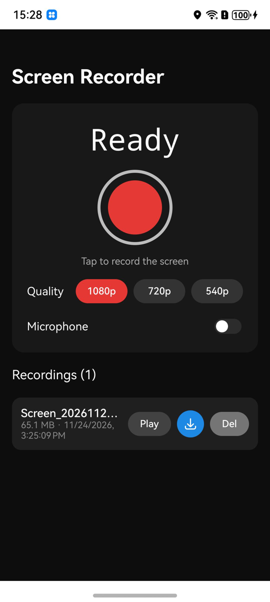

# Screen Recorder

A simple screen recorder for OpenHarmony. It records the whole screen to an
MP4 file (H.264 video, AAC audio) with the system's `AVScreenCaptureRecorder`,
so the encoding runs in the media service on the device's video encoder.



* Tap the red button and allow recording in the system's privacy notice. The
  recording goes on while you use other apps; come back and tap the square to
  stop.
* Quality: 1080p (1080×2400, 16 Mbit/s), 720p (8 Mbit/s) or 540p
  (4 Mbit/s). The video keeps the screen's aspect ratio.
* Audio: what the device plays is always recorded. Turn on **Microphone** to
  add your voice (asks for the microphone permission).
* Recordings are listed in the app: play them, save them to Photos (the
  system's save button, no storage permission needed) or delete them.

## Permissions

* `ohos.permission.MICROPHONE`, only when the microphone is switched on.

Screen capture itself needs no permission: the system asks the user in its
privacy notice each time a recording starts.

## Build

Stage model, ArkTS. It compiles against API 23 (OpenHarmony 6.1 SDK) with
`compatibleSdkVersion` 20. Tested on OpenHarmony 7.0 (Volla Phone Plinius).

```
ohpm install
hvigorw assembleHap --mode module -p product=default -p buildMode=release --no-daemon
```

Or with [oniro-app](https://www.npmjs.com/package/@oniroproject/oniro-app):
`oniro-app sign && oniro-app build && oniro-app app install`.

## Release

Pushing a `v*` tag builds the app in GitHub Actions and publishes it to the
[Oniro App Store](https://store.iparo.app)
(`.github/workflows/oniro-store.yml`). Bump `versionCode` and `versionName`
in `AppScope/app.json5` first.

## License

Apache-2.0, see [LICENSE](LICENSE).
